# todo.nvim

[English](README.md) | [简体中文](README.zh-CN.md)

[](https://github.com/InubashiriLix/TodoAnxiety.nvim/actions/workflows/test.yml)
[](https://github.com/InubashiriLix/TodoAnxiety.nvim/actions/workflows/core.yml)
[](https://github.com/InubashiriLix/TodoAnxiety.nvim/actions/workflows/server.yml)
[](https://github.com/InubashiriLix/TodoAnxiety.nvim/releases)


**An AI-native, Rust-powered Neovim task workspace that syncs across devices.**

Tasks, notices, routines, AI planning, images, and multi-device sync in one
keyboard-driven workflow. AI turns vague input into reviewable drafts; the Rust
core keeps urgency, duration, and recurrence deterministic.

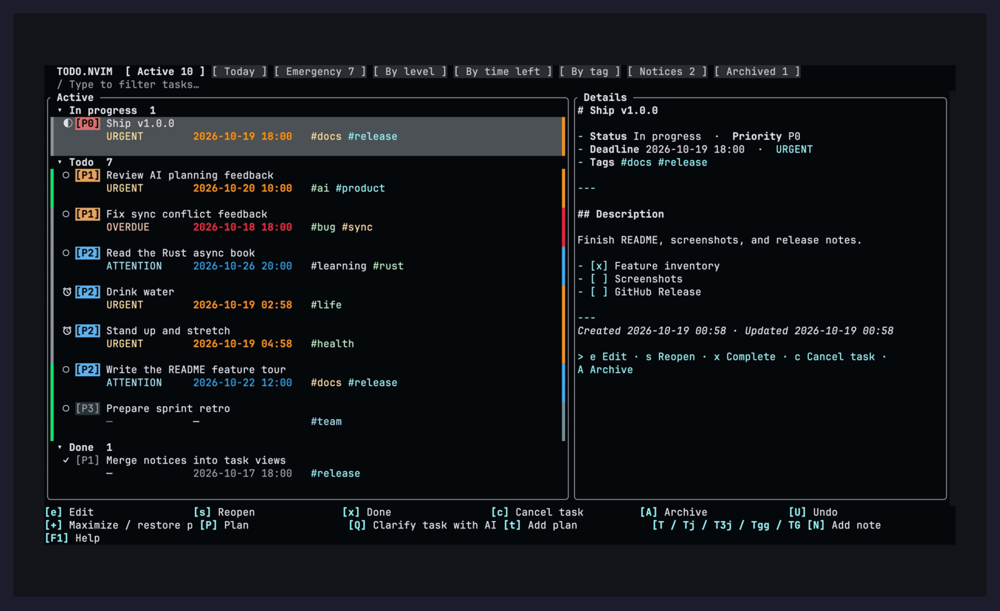

## Why todo.nvim

Most Neovim TODO plugins solve “recording.” todo.nvim tries to solve “deciding
what is next, then actually doing it.”

- **AI is part of the workflow**: capture, create, revise, clarify, and daily
  planning each have a dedicated entry point. AI can ask questions, offer
  choices, and read sources, but nothing is written before approval.
- **Explainable ranking**: the Rust core owns urgency, duration, recurrence, and
  task reads, so the UI can explain why a task is at the top.
- **Tasks and reminders are one system**: notices appear in normal task views,
  Today, and AI planning. Completing an occurrence advances the next one.
- **Local-first, optional sync**: SQLite stays on your machine. Git sync talks
  to the network only during `:Todo sync`; the single-binary Rust server is
  optional.
- **Built for the keyboard**: five scopes and four groupings, folds, search and filters, contextual
  hints, three-row cards, inline images, and scrollable help.

## Feature overview

| Capability | What you get |
| --- | --- |
| AI workspace | `capture` / `add ai` capture, `revise` edits, `Q` clarification, `plan` sequential review, `today` execution |
| Reviewable AI | question options, per-option notes, sourced memory, draft approval, batch `U` undo, cost estimates |
| Multiple providers | DeepSeek, OpenAI Responses, Anthropic Messages, and OpenAI-compatible services |
| Permissions and sandbox | scoped source reads, command approval, read-only sandbox, redacted diagnostics |
| Rust core | required; urgency, duration, recurrence, and task reads |
| Routines | daily, weekdays, selected weekdays, and fixed intervals; templates create normal task instances |
| Notices | sound, forced focus, snooze, postpone, and missed-reminder catch-up |
| Five scopes × four groupings | Today, Active, Emergency, Notices, Archived; Status, Urgency, Time left, Tag |
| Task UI | three-row cards, left/right urgency bars, AI marks, folds, search, filters, undo/redo |
| Sync | manual Git sync, UUIDs, conflict merge, attachments, optional Rust server |
| Engineering | SQLite, async networking, Neovim 0.10.4/stable CI, four-target core build |

## Contents

- [Why todo.nvim](#why-todonvim)
- [Feature overview](#feature-overview)
- [Requirements](#requirements)
- [Usage](#usage)
- [Screenshots](#screenshots)
- [AI workspace](#ai-workspace)
- [Dashboard and form](#dashboard-and-form)
- [Configuration](#configuration)
- [Multi-device sync](#multi-device-sync)
- [Emergency ranking](#emergency-ranking)
- [Data and lifecycle](#data-and-lifecycle)
- [Scope and limits](#scope-and-limits)
- [Development](#development)

## Requirements

- Neovim 0.10+
- **Rust core** (`todo-core`): required, there is no Lua fallback. Build it with
  `cargo build --release --manifest-path core/Cargo.toml` (or use a release
  artifact), or set `core.bin` / `$TODO_CORE_BIN`.
- [`kkharji/sqlite.lua`](https://github.com/kkharji/sqlite.lua)
- [`MunifTanjim/nui.nvim`](https://github.com/MunifTanjim/nui.nvim)
- [`folke/which-key.nvim`](https://github.com/folke/which-key.nvim) v3 (optional,
  for the dedicated keymap icon column)
- A system SQLite shared library (`libsqlite3.so`, `libsqlite3.dylib`, or
  `sqlite3.dll`)
- Neovim's bundled `markdown`/`markdown_inline` treesitter parsers, for
  markdown rendering in the detail pane and description editor (present in
  stock Neovim; if missing, rendering silently falls back to plain text)

> **Known incompatibility:** since the detail pane and description editor set
> `filetype = markdown`, any installed markdown-rendering plugin that attaches
> via `FileType markdown` will try to render them too. This is usually
> harmless, but plugins that defer their setup with a timer and don't
> re-check buffer validity when it fires can error if the popup is closed in
> that window (e.g. `mdmath.nvim`, which defers ~100ms). todo.nvim reuses one
> long-lived buffer for both detail surfaces to shrink that race, but cannot
> eliminate it for every third-party plugin. If you hit an error like this,
> it's worth reporting to that plugin, or setting `ui.markdown = false` to
> opt the detail pane out of `filetype = markdown` entirely.

Example with lazy.nvim:

```lua
{
  "InubashiriLix/TodoAnxiety.nvim",
  dependencies = {
    "kkharji/sqlite.lua",
    "MunifTanjim/nui.nvim",
    -- Optional; configure image.nvim separately as documented below.
    "3rd/image.nvim",
  },
  config = function()
    require("todo").setup()
  end,
  build = "cargo build --release --manifest-path core/Cargo.toml",
}
```

Run `:checkhealth todo` after installation.

[Inline image configuration and troubleshooting](doc/images.md).

## Usage

```vim
:Todo                         " open the active-task float
:Todo open sidebar emergency " emergency view in the sidebar
:Todo today                   " open today's execution queue
:Todo plan                    " open AI daily planning
:Todo add Write release notes " prefill a new-task form
:Todo add ai I need to call the bank " let AI clarify and draft a new task
:Todo capture messy notes        " AI-assisted capture (questions, then draft review)
:Todo revise 42                " ask AI to update task 42 after approval
:Todo clarify 42               " ask AI to clarify task 42
:Todo notice Take a shower    " create a notice
:Todo routines                " manage recurring routines
:Todo open notices            " list active notices
:Todo tags                    " open the tag manager
:Todo ai setup                " configure provider, model, and key
:Todo diagnostics             " inspect redacted diagnostics
:Todo done 42                " complete task 42
:Todo archive 42             " archive while keeping the task recoverable
:Todo delete 42              " permanently delete an archived task
:Todo restore 42
```

All commands use the single `:Todo` entry point:

```text
open [float|sidebar] [today|active|emergency|by_urgency|by_time|by_tag|notices|archived]
toggle [float|sidebar]
today [YYYY-MM-DD]
plan [YYYY-MM-DD]
add [ai] [title]
capture [text]
revise [id]
clarify [id]
notice [title]
routines
tags
image <path>
sync [status|conflicts]
ai setup|key|settings|usage|balance|memory
diagnostics
edit [id]
start|done|cancel|reopen [id]
archive|restore|delete [id]
close
```

When an ID is omitted inside a todo panel, the task under the cursor is used.

Default global mappings:

| Mapping      | Action                   |
| ------------ | ------------------------ |
| `<leader>Tt` | Toggle the default panel |
| `<leader>Ta` | Add a task               |
| `<leader>Tf` | Open the floating panel  |
| `<leader>Ts` | Open the sidebar         |
| `<leader>Te` | Open the emergency view  |
| `<leader>Tg` | Manage tags              |
| `<leader>Tn` | Add a notice             |

Operation hints follow the focused window, selected task, field, and editing
mode throughout the plugin. Footers wrap to show available actions; `?` in
Normal mode or `F1` in either mode opens the complete, grouped, scrollable help.
Closing help restores focus and editing mode. `?` remains ordinary text in
Insert mode. Existing global mappings are never overwritten.

Task actions match the current state: Todo offers start/complete/cancel;
In progress offers return to Todo/complete/cancel; completed or cancelled tasks
offer `s` to resume In progress and `u` to reopen as Todo. Overdue open tasks
also offer `p` to postpone. Archived tasks offer edit, `R` to restore, and `D`
to delete with confirmation; restore them before changing their status.
Unavailable task operations do not modify the task.

In the dashboard, details, and reminder popup, `U` undoes the last saved task
operation and `Ctrl+r` redoes it. History covers status changes, editing,
postponement, archiving/restoring, and reminder actions within the current
Neovim session (up to 50 steps). New changes clear redo history. Undo refuses
to overwrite a task changed elsewhere, including by sync. New task creation,
permanent deletion, and bulk tag changes are not undoable in this version.
Unsaved text editing continues to use Neovim's native undo.

The `/` search input closes as soon as focus moves away from it. A floating
dashboard also closes whenever focus enters a regular editing window, while
its own detail, menu, search, and tag-manager windows are treated as part of
todo.nvim. A sidebar remains available after focus returns to the editor.
The dashboard blocks mouse navigation and `Ctrl-h/j/k/l` locally to keep focus
inside its controls. In AI planning, Normal-mode `Ctrl-h/j/k/l` moves between
panes. Mappings in ordinary editing buffers remain unchanged.

In the archived view, select a task and press `D` to open a confirmation menu;
Cancel is selected by default to prevent an accidental Enter from deleting it.
`:Todo delete [id]` provides the command equivalent. Only archived tasks can be
permanently deleted, and deletion cannot be undone.

## Screenshots

### Task views

| Emergency | By time left |
| --- | --- |
| 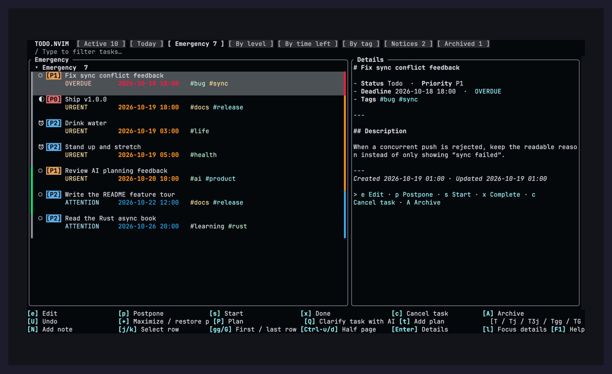 | 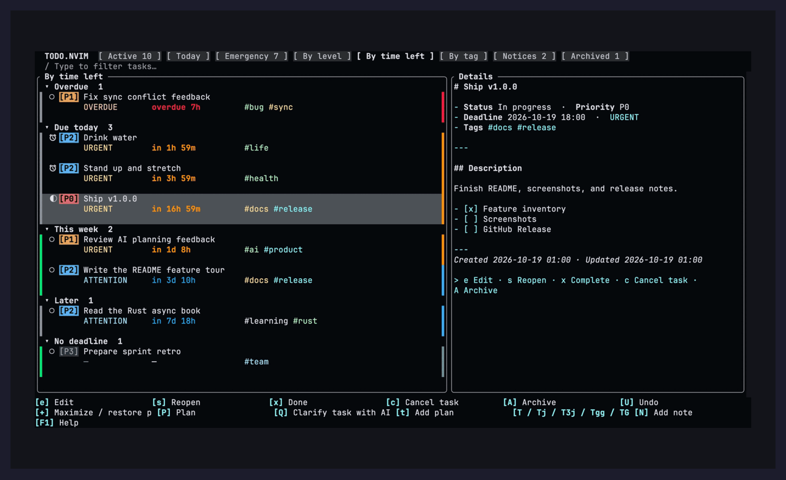 |
| Urgency ranking, so the next thing is already at the top | Relative-time labels, grouped by time remaining |

| By tag | Notices |
| --- | --- |
| 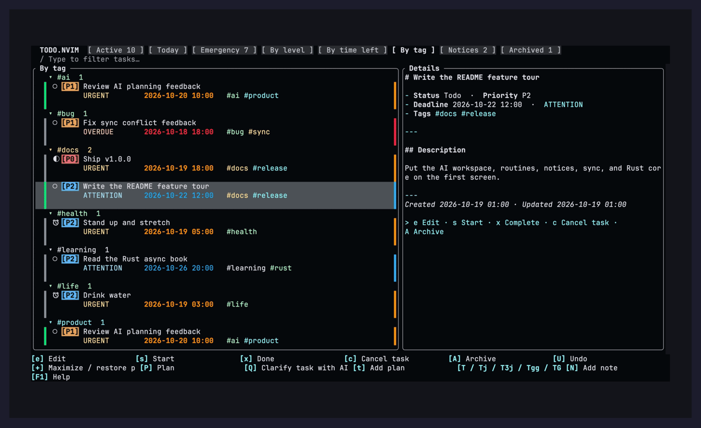 | 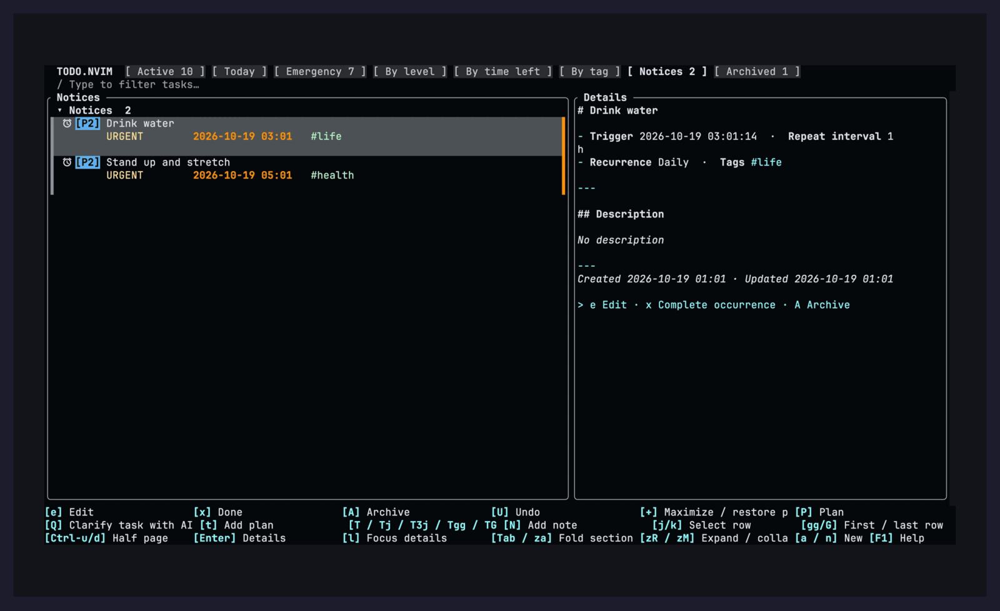 |
| A tag tree; a multi-tag task appears under every tag | Notices have their own view and stay in normal task views |

### Today and management

| Today | Tag manager |
| --- | --- |
| 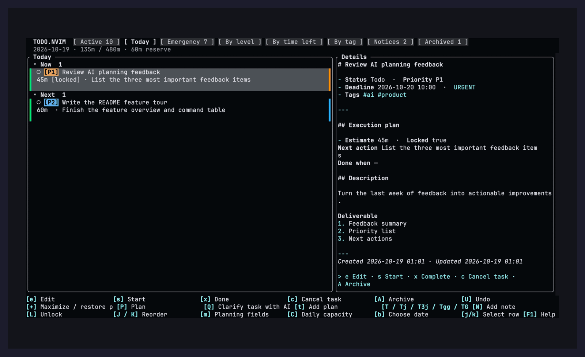 | 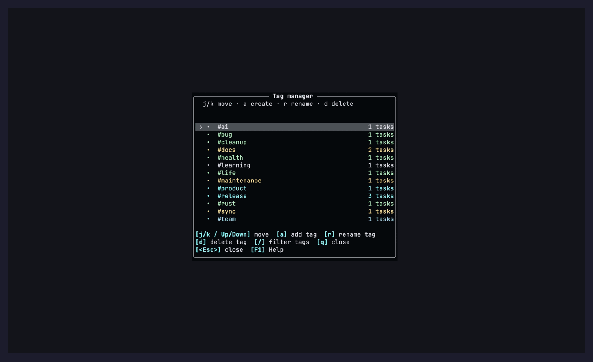 |
| Capacity, locked items, next action, and completion criteria | Create, rename, delete, filter, and inspect usage |

### Forms

| Edit task | New notice |
| --- | --- |
| 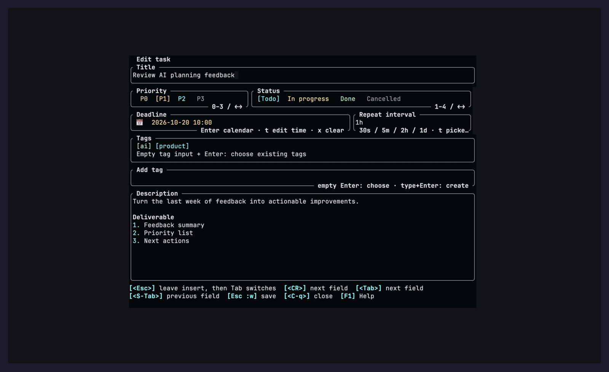 | 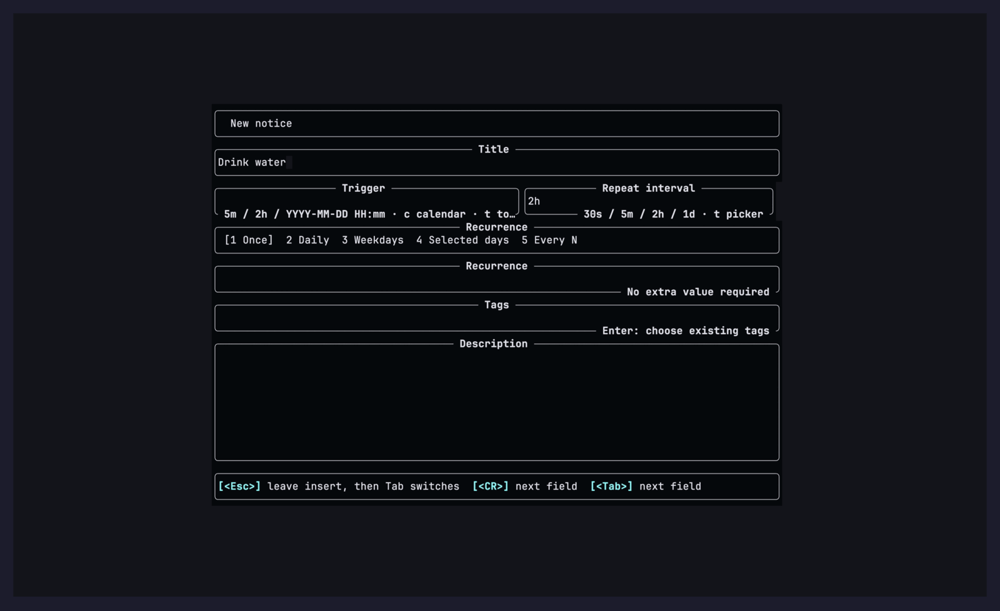 |
| Priority, status, deadline, reminder, tags, and multi-line Markdown | Trigger, repeat interval, recurrence, and a four-part duration picker |

<details>
<summary><b>More view screenshots</b></summary>

| By level | Archived |
| --- | --- |
| 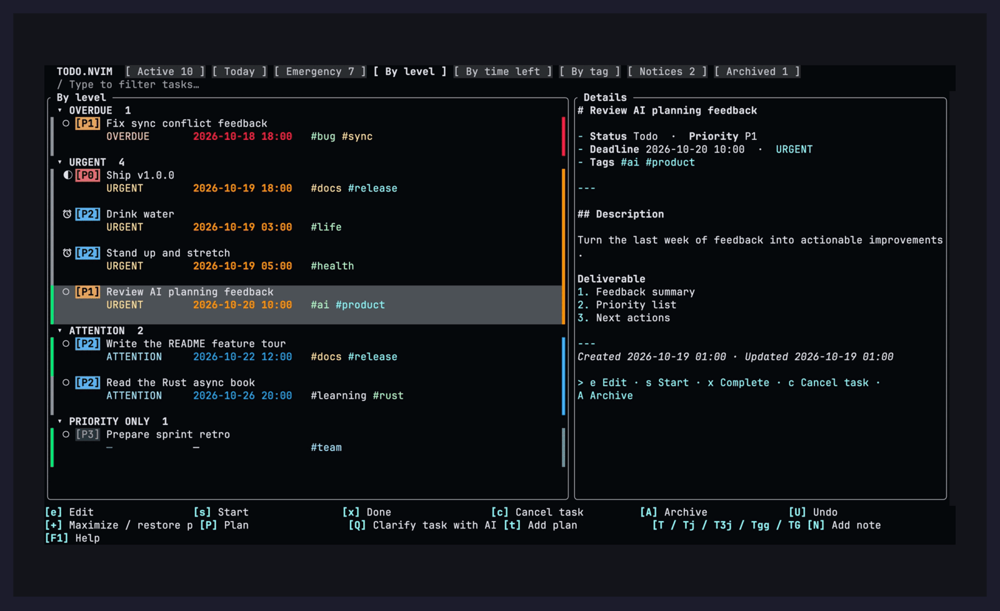 | 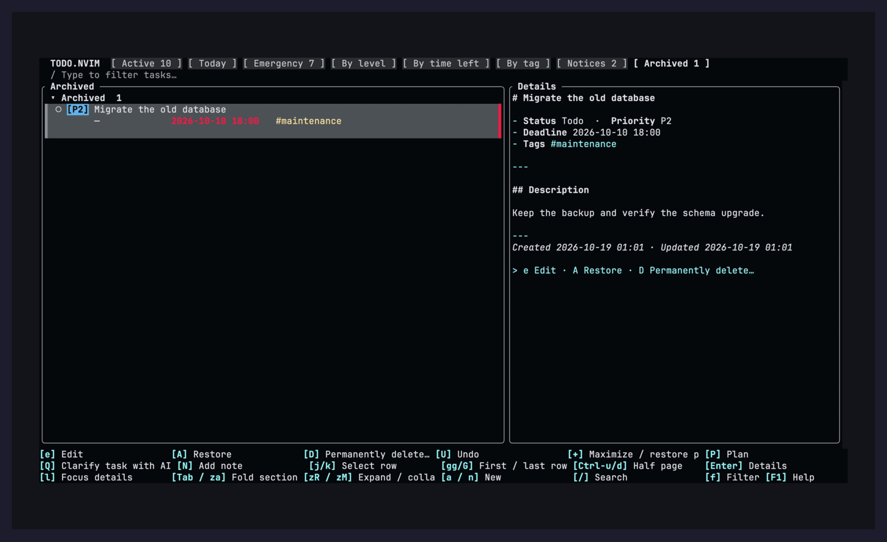 |
| Overdue, urgent, high, attention, and priority only | Archived tasks can be restored or permanently deleted |

</details>

## AI workspace

AI in todo.nvim is not “generate a paragraph.” It is an approval-gated task
pipeline.

### Four entry points

| Entry point | Purpose |
| --- | --- |
| `:Todo capture [text]` / `:Todo add ai [text]` | Turn messy input into a task draft; AI asks first, then prepares a review |
| `:Todo revise [id]` | Update an existing task with its original context; write only after approval |
| `Q` / `:Todo clarify [id]` | Clarify the goal, deliverable, and acceptance criteria of one task |
| `:Todo today` / `:Todo plan` | Today's execution queue / sequential AI planning |

### Sequential daily planning

`:Todo plan` opens a daily workspace independent of deadlines. In the default
plan mode, AI changes become individually reviewed drafts; one `U` after apply
undoes the whole batch. Nothing is selected initially: `t` toggles the current
task, `T` starts a range, and `Tj` / `T3j` / `Tgg` / `TG` apply it in bulk.
`M` switches plan / build / auto; `y/Y/n` approves source and command requests.

| Daily planning | AI clarification |
| --- | --- |
| 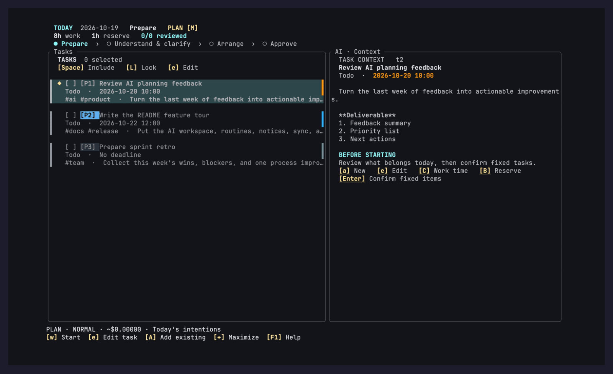 | 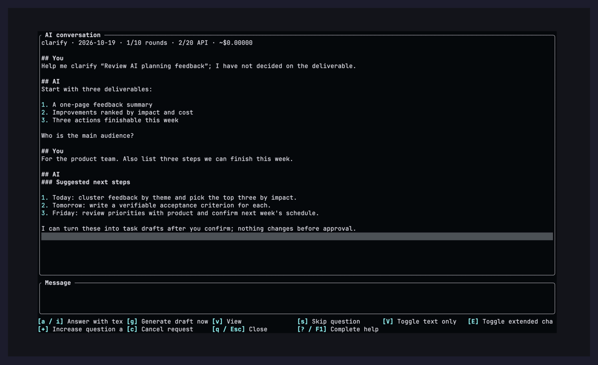 |
| Sequential understanding, options, approval, and sourced context | Full-width timeline, inline composer, streaming replies |

### Configuration

Enable `ai.enabled = true`, then run `:Todo ai setup` to choose a provider and
enter a hidden key, or run `:Todo ai key`, or use `DEEPSEEK_API_KEY`. Supported
providers are DeepSeek, OpenAI Responses, Anthropic Messages, and any Chat
Completions-compatible service. OpenAI and Anthropic require an explicit model.
Device-local credentials are stored with mode 0600 and never synced.
`:Todo ai settings` edits language and persona. Each conversation defaults to
ten question rounds and twenty requests, with visible cost estimates;
`:Todo ai usage` / `:Todo ai balance` inspect usage.

### Images, memory, permissions, and diagnostics

Paste images into task descriptions and AI answers; files are copied into
managed storage. AI can maintain sourced memory and is constrained by scoped
permissions, command approval, and a read-only sandbox. Network IO is async and
shows stages, elapsed time, and errors. Use `:Todo diagnostics` for redacted
logs and `:checkhealth todo` for local setup checks. See
[AI permissions and sandboxing](doc/ai-permissions.md),
[the planning guide](doc/planning.md), and
[the single-binary server guide](server/README.md).

## Dashboard and form

The floating dashboard uses a task list and fixed detail pane when at least 100
columns are available. Narrow floats and the sidebar use two-line task cards;
press Enter to open the selected task in a detail popup.

The detail pane and popup render the task as markdown: title, status,
priority, deadline, urgency, and tags as a field list, followed by the
description exactly as typed. `filetype` is set to `markdown`, so a rendering
plugin such as `MeanderingProgrammer/render-markdown.nvim`, if installed,
attaches automatically; without one, Neovim's built-in treesitter highlighting
still applies. Set `ui.markdown = false` to disable this and see the raw
markdown source instead. The description field in the add/edit form is the
same filetype, so writing lists, checkboxes, or fenced code there highlights
live and shows up rendered in the detail pane afterward.

### Views

The header keeps five scope tabs; `[` and `]` cycle them and the active scope is
highlighted. Grouping is a separate choice: press `o` to cycle Status, Urgency,
Time left, and Tag, or `v` for the full view picker. This keeps the tab bar from
growing every time a new grouping is added.

| Scope | Content |
| --- | --- |
| Today | An execution queue independent of deadlines, grouped by capacity and plan |
| Active | All tasks |
| Emergency | Urgency-ranked flat list of candidates only |
| Notices | Reminders ordered by next trigger |
| Archived | Archived tasks, newest first |

Active, Today, and Emergency support these groupings:

| Grouping | Meaning |
| --- | --- |
| Status | In progress, todo, done, cancelled |
| Urgency | Overdue, urgent, high, attention, priority only |
| Time left | Overdue, due today, this week, later, no deadline; cards show a relative `in 3d 4h` label |
| Tag | One root per tag plus Untagged; a task with several tags appears under each of them |

`by_urgency`, `by_time`, and `by_tag` remain valid `:Todo open` arguments and
mean "Active with that grouping".

Every section header can be folded: `<Tab>` or `za` toggles the section holding
the cursor, `zR` expands all, and `zM` collapses all. Folds are remembered per
view for as long as the panel stays open. `j` and `k` walk section headers as
well as tasks, so the tag view navigates like a tree. Search and the status,
priority, and tag filters apply on top of whichever view is active.

In the task list, `gg` and `G` select the first and last row, while `Ctrl+U`
and `Ctrl+D` move by half the visible list height. When a jump lands on a task,
the selected task and details update. In the fixed detail pane and detail popup,
`j`/`k`, `gg`/`G`, and `Ctrl+U`/`Ctrl+D` navigate the detail text and keep the
selected task unchanged. In a wide dashboard, `l` enters details and `h` returns
to the list. The existing `g` tag-management shortcut remains available in the
dashboard.

Press `p` on an overdue task to open a postponement input prefilled with `1d`.
Press Enter to postpone it by 24 hours from submission, or enter a custom
duration such as `2h`, `3d`, or `1d2h`. The new deadline is rounded up to the
next whole minute; date-only deadlines gain an explicit time. Existing reminders
move to the new deadline, keeping their interval and recurrence settings.
Escape or Ctrl-Q cancels. This works in the task list, sidebar, details, and overdue task reminders;
only unarchived overdue tasks in Todo or In progress status can be postponed.

Escape unwinds one layer at a time. In the search box it clears the query,
closes the input, and returns the cursor to the list, from either Normal or
Insert mode. In a menu, help popup, or detail overlay it closes that window. On
the list it clears any active filters, or closes the panel when none are set.

### Routines

`:Todo routines` manages recurring templates: daily, weekdays, selected
weekdays, or a fixed interval. A template materializes ordinary task instances,
so completing one occurrence never changes the following ones. Use it for daily
reviews, weekly planning, and maintenance chores.

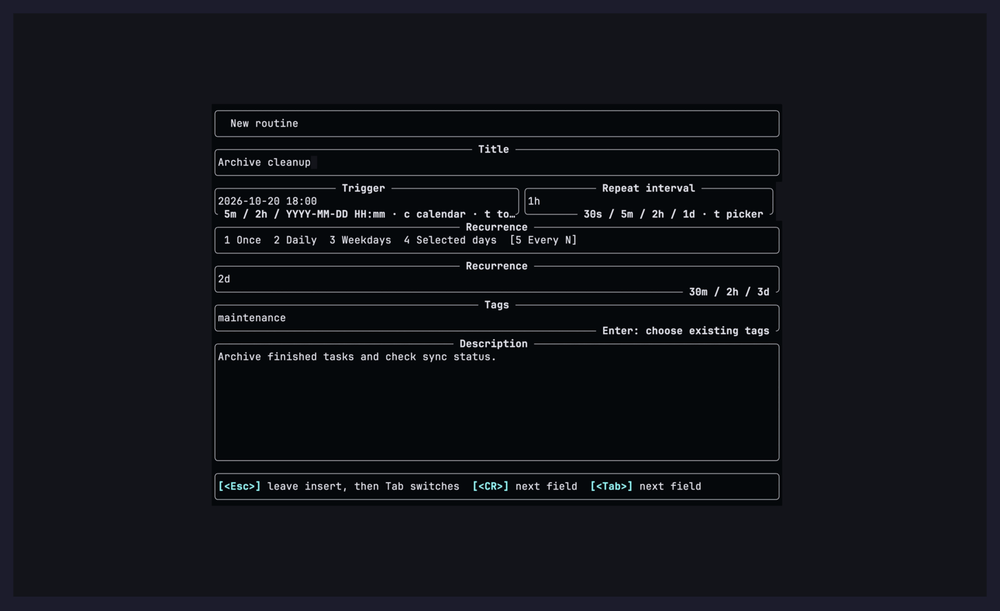

Notices handle short-lived reminders such as “take a shower in five minutes.”
Create one with `:Todo notice [title]`; its trigger accepts `30s`, `5m`, `2h`,
or an exact date, and `c` opens the keyboard calendar and unrestricted time
editor. Recurrence supports once, daily, weekdays, selected weekdays, and every
N minutes, hours, or days. The repeat interval remembers its last value. Press
`t` on that field for a four-part days/hours/minutes/seconds picker, or keep
typing compact values such as `5m` directly.

When due, todo.nvim plays a sound and focuses a reminder popup: `d` completes
the occurrence, `s` snoozes by a relative duration, `p` postpones an overdue
ordinary task with a `1d` default, `a` archives,
and `q` closes only the current popup. Unhandled items continue at their own
repeat interval. Missed reminders fire immediately when Neovim starts or the
machine resumes; no sound can play while Neovim is completely stopped.

The add/edit form uses separate controls instead of parsing a text buffer:

- A title input with inline validation
- A visible P0–P3 priority selector (`0`–`3`, arrow keys, or Enter menu) and a
  four-part status selector (`1`–`4`, arrow keys, or Enter menu)
- A keyboard calendar for choosing the date and an unrestricted time editor:
  type `HHMM` directly, adjust by one or five minutes/hours, or keep the task
  date-only. The picker shows date, hour, and minute together and rolls the date
  when crossing midnight. No fixed time presets or hidden mouse-only date buttons.
- A dedicated tag panel for selecting, creating, renaming, deleting, filtering,
  and inspecting usage counts; press Enter on an empty tag field, then use
  `j`/`k` and Enter/Space to toggle tags. You can also
  manage tags globally with `:Todo tags`/`<leader>Tg`. Deleting a tag removes
  that tag from every associated task after confirmation; tasks are not deleted.
- An independent multi-line description editor

Use Tab and Shift-Tab to move between fields. In the description editor's
Insert mode, Tab and Shift-Tab are left to editing and completion plugins;
press Escape first, then Tab or Shift-Tab to switch fields. Use `:w` to save, `:wq` / `:x` to save and return, and Normal `+` to maximize the focused field. Use `q` or Escape
in Normal mode, or `<C-q>` from either mode, to close. In Insert mode Escape
still only leaves Insert, so it never closes a field you are typing in. Unsaved
forms ask whether to save, discard, or continue editing. Dashboard buffers locally
block mouse clicks/drags and Ctrl-h/j/k/l to protect keyboard selection; mappings
in other windows remain unchanged. AI panes support Normal-mode Ctrl-h/j/k/l.
When a form is opened from a dashboard,
the dashboard is suspended and restored afterward so the two interfaces never
overlap.

## Configuration

```lua
require("todo").setup({
  db_path = vim.fn.stdpath("data") .. "/todo.nvim/todo.db",
  language = "en", -- "en" or "zh-CN"
  -- Optional manual sync. Use a dedicated private, empty Git repository.
  -- Configure Git credentials on each device, then run :Todo sync.
  sync = {
    enabled = false, -- Change to true after setting your remote.
    remote = "", -- e.g. "git@github.com:YOUR_NAME/private-todos.git"
    branch = "main", -- Same remote and branch on every device.
  },
  ui = {
    default_mode = "float", -- "float" or "sidebar"
    -- "active", "emergency", "by_urgency", "by_time", "by_tag", "notices", or
    -- "archived"
    default_view = "active",
    -- Render the detail pane and description editor as markdown.
    markdown = true,
    float = { width = 0.80, height = 0.75, border = "rounded" },
    sidebar = { width = 42, side = "right" },
  },
  -- Each entry is the full key string, or false to disable.
  keymaps = {
    toggle = "<leader>Tt",
    add = "<leader>Ta",
    open_float = "<leader>Tf",
    open_sidebar = "<leader>Ts",
    open_emergency = "<leader>Te",
    manage_tags = "<leader>Tg",
    add_notice = "<leader>Tn",
  },
  -- Optional which-key v3 icon metadata.
  -- A plain string is also accepted; use false or "" to disable one icon.
  icons = {
    toggle = { icon = "\u{f204}", color = "yellow" },
    add = { icon = "\u{f067}", color = "green" },
    open_float = { icon = "\u{eb7f}", color = "blue" },
    open_sidebar = { icon = "\u{f03c7}", color = "cyan" },
    open_emergency = { icon = "\u{f071}", color = "orange" },
    manage_tags = { icon = "\u{f02c}", color = "purple" },
    add_notice = { icon = "\u{f0f3}", color = "orange" },
  },
  reminders = {
    enabled = true,
    sound = {
      path = "/path/to/reminder.ogg",
      command = { "mpv", "--no-video", "--really-quiet" },
    },
  },
})
```

When which-key v3 is available, todo.nvim passes these values through
`which-key.add()` as native `icon` metadata. The popup therefore renders a
separate, aligned, color-highlighted icon column. Without which-key, the
mappings still work and their descriptions remain clean text.

The sound command is executed as an argv list without a shell. Set `command`
to `false` to auto-detect `mpv`, `ffplay`, `paplay`, or `afplay`; an empty path,
unreadable file, or missing player falls back to the terminal bell. A repeat
interval is required when a regular task has a deadline; tasks without a
deadline do not create reminders.

The plugin stores one global database rather than one database per project.
Back up the configured `.db` file after closing Neovim, or use SQLite's backup
tools while it is open.

## Multi-device sync

Optional Git sync works with a local SQLite database on each macOS or Linux
device. Install Git 2.28+ and use the same updated plugin version everywhere.
Only `:Todo sync` accesses the remote: there is no background, startup, focus,
or shutdown sync. You can keep editing offline.

1. Create a dedicated **private, empty Git repository**, without a README,
   license, or `.gitignore`. Do not use the plugin source repository.
2. Configure Git authentication on each device. For SSH, complete the initial
   host-key verification in a terminal and load your key into an agent. For
   HTTPS, use your Git credential helper. Sync cannot answer interactive prompts.
3. On the device containing your existing todos, add this to your setup and run
   `:Todo sync`:

   ```lua
   require("todo").setup({
     sync = {
       enabled = true, -- disabled by default
       remote = "git@github.com:YOUR_NAME/private-todos.git",
       branch = "main",
     },
   })
   ```

4. On your Mac or another device, install the plugin and dependencies, use the
   same sync configuration with a fresh local database, then run `:Todo sync`.
   No database copying or manual Git checkout is needed.
5. Run `:Todo sync` on the device you are leaving, then on the device you are
   switching to. Both devices may also edit offline and sync later.

`:Todo sync status` reports the last success, pending local records, latest
error, and cache path. It does **not** check the remote. `:checkhealth todo`
checks Git and local paths without accessing the network. The equivalent Lua
entry points are `require("todo").sync()` and `require("todo").sync_status()`.

While syncing, a non-focusable card shows preparation, download, merge, local
update, upload, elapsed time, and retries. It remains visible throughout network
waits, independently of notification plugins. Completion stays visible for eight
seconds and reports this run's uploaded/downloaded change records (not task
counts); an unchanged sync explicitly says everything is up to date. Failures
remain visible for fifteen seconds. Final results also appear in `:messages`.
Edits still pending after completion are called out for the next manual sync.

Tasks, notices, tags, archives, deletions, reminder rules, occurrence completion,
and snoozes sync. Sound paths, UI preferences, last-used input values, and bell
delivery progress stay local. Both devices can ring while disconnected. Due
date text keeps its existing local-time meaning; scheduled reminder instants
are shared as Unix timestamps. Daily/weekly recurrence is advanced using the
timezone of the device completing the occurrence.

Concurrent edits use the newer **whole task**, including its tags and reminder
configuration. There is no field-by-field merge. Millisecond timestamps,
logical sequence numbers, and device identities provide a deterministic order;
incorrect device clocks can still affect concurrent offline edits. UUIDs
identify tasks across devices; numeric IDs in `:Todo done 42` are local and
may differ. An open form refuses to overwrite a task changed since it opened;
copy unsaved text and reopen it before saving.

The plugin stores immutable JSON transactions in Git and keeps the SQLite
database local. Its managed Git directory is `<db_path>.sync`. Do not edit or
commit files there manually, and do not place the live database in a synced
folder. Tag deletion suppresses old associations; recreating that name does
not restore them. Deleting tasks removes them from current lists but **retains
their old content in SQLite sync history and Git history**. History pruning
and encryption beyond your Git transport/provider are not included.

Network/authentication failures retain pending records. Fix authentication or
connectivity and run `:Todo sync` again. A sync process has a 30-second timeout
per Git command, retries concurrent pushes up to three attempts, and never
force-pushes. Changes made during a running sync can remain pending until the
next invocation. Invalid or unsupported remote data leaves the database
unchanged for that import batch; preserve the database and inspect the reported
record/format error rather than overwriting either copy.

Schema v3 adds UUIDs and a durable change journal even with sync disabled. An
existing database gets a consistent `<db_path>.pre-sync-<uuid>.db` backup before
migration; keep it if you need to roll back to an older plugin version. Disabling
sync preserves local use. For cache recovery, close Neovim, move only
`<db_path>.sync` aside, then reopen and sync; the database journal rebuilds it.
Keep the same remote and branch for a database; use a separate `db_path` for a
different sync repository. Initialize secondary devices from an empty database,
since independently migrated copies of an old database get different UUIDs.

## Emergency ranking

Only unarchived `todo` and `in_progress` tasks are candidates. Every task with a
deadline is included; P0 and P1 tasks without a deadline are included too.

Deadline scores are 120 for overdue, 80 within 24 hours, 60 within three days,
40 within seven days, 20 later, and 0 without a deadline. Priority adds 30 for
P0, 20 for P1, 10 for P2, and 0 for P3. The UI shows a level and explanation,
not the numeric score. Overdue work always stays ahead of non-overdue work.

Deadlines accept `YYYY-MM-DD` or `YYYY-MM-DD HH:mm` in local time. A date without
a time means 23:59:59 on that date.

## Data and lifecycle

Tasks have a title, multi-line markdown description, status, P0–P3 priority,
optional deadline, and zero or more tags. Statuses are `todo`, `in_progress`,
`done`, and `cancelled`. Tasks can be archived, restored, and—only after they
have been archived—permanently deleted. Notices and task deadlines persist
their reminder state. Existing databases migrate to schema v3 without enabling
sound for old tasks until a reminder interval is saved.

## Scope and limits

todo.nvim is for people who want both their tasks and their AI workflow inside
Neovim. It is not a hosted SaaS and does not make decisions for you.

- Neovim 0.10+; the Rust core is a hard dependency with no Lua fallback.
- AI needs your own API key; requests are billed by the provider, and the UI
  shows cost estimates.
- Sync is manual. Only `:Todo sync` accesses the network; there is no background
  real-time sync.
- Permanent deletion is limited to archived tasks and cannot be undone. New task
  creation, permanent deletion, and bulk tag changes are outside the current
  undo history.
- Tasks, notices, and plans live in local SQLite. Git sync retains history;
  deleting a task does not erase it from Git history.
- AI writes are approval-gated by default. Model choice, capabilities, and
  context limits depend on the provider you configure.

## Development

Run the dependency-free headless suite with:

```sh
bash scripts/test.sh
```

SQLite integration tests run when `kkharji/sqlite.lua` is available on
`runtimepath`; NUI integration tests similarly require `nui.nvim`. The test
script automatically detects the usual lazy.nvim paths, or accepts
`TODO_SQLITE_PATH` and `TODO_NUI_PATH`.

With SQLite available, the suite also runs two-device sync tests against local
bare Git repositories, without GitHub credentials or network access. CI runs
on Linux and macOS with Neovim 0.10.4 and the current stable release.

README screenshots are rendered headlessly by `scripts/screenshots/render.sh en`
(or `zh`) with VHS and ffmpeg. Demo state is written only to the ignored
`scripts/screenshots/.demo/` directory.

[Lua configuration](doc/configuration.md) · [Authentication and security](doc/security.md)
